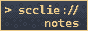

# shiza.sccl.cc

fork of [quartz4](https://github.com/jackyzha0/quartz)

my personal blog

---

## Fork features

- **Bilingual content** — `content/ru/` + `content/en/` with client-side language filtering across all components (no redirects)
- **SidebarButtons** — custom `[explorer]` `[search]` `[theme]` `[recents]` links in terminal style
- **ExplorerPage** - custom page with folder toggles and RU/EN language filter toggle (client-side, not navigation)
- **SearchPage** - custom page with index search.
- **RecentsContent** — custom page with language filtering
- **Random note** — `[random note]` button picks a random page from current language list
- **Prev/Next navigation** — `[<- prev]` `[next ->]` buttons walk through recents by date
- **RecentNotes** — enhanced sidebar component with date display, language filtering, and random note
- **Mobile layout** — single column, hidden TOC/recents sidebar, responsive center card
- **CSS overrides** — Nord-colored headings, terminal blockquotes, custom breadcrumbs/tags/tables

---

 
