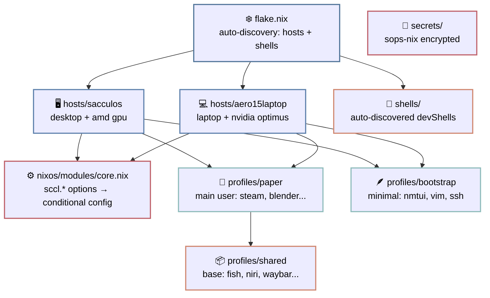

# If this shitpost-like article looks like insanity
Proper documentation: [github/scclie/sccl_nix/README.md](https://github.com/scclie/sccl_nix)


# Why ~~the f*&^~~ ?

I used to not get it either -- after 6 years of arch-only, that is.
Like, great, another hype distro, just like fedora, manjaro and the rest of the bandwagon.

And then I decided to install it...

After that, well, my world kinda flipped.
A ton of problems I struggled with on regular distros just... resolved. Instantly.
I didn't even realise they were problems before -- after years on standard distros you reach a consensus, you just learn how to work with them so everything is fine.
But that "fine" and this "fine" -- these are two completely different fines.

There's this old thought, from way back when Nix was being conceived -- package managers can actually be compared to programming languages. (I could only quickly find a paper on Guix, but the idea surfaced even earlier https://en.wikisource.org/wiki/Functional_Package_Management_with_Guix)

So you've got procedural package managers -- the standard apt, yum, pacman etc (basically all imperative ones, where you manually install stuff or write sequential scripts for it)
And declarative ones -- that's exactly nix, and guix too -- more of a functional approach, where you describe the result instead.

and what's next? An even higher-level approach, more abstract? (or like some mega-abstract llm-based chat interface??????? -- ai problem resolver :D )

Anyway, for now nix is the best we've got. Here's why.

The imperative approach in linux looks like: `apt install something`, then `systemctl enable something`, then manually edit `/etc/something/something.conf`. The system accumulates state, and you have no idea how it got where it is. Running fucking git for `/etc`? fr

NixOS does the opposite (basically like functional vs procedural PLs): you describe the end result. All packages, configs, users, services -- one file (well you can have more than one...), one build, one state. Not "install this and that" (PKGBUILD), but "here's what my system should be". Want a second machine? Same configs, different host. Want to roll back? Slam in the previous generation. The system is immutable -- every build sits in `/nix/store` (all in one pile of crap, but nicely linked with symlinks), nothing gets scattered across `/usr` and `/etc`.

And the separate bliss of shells. You often end up installing "disposable programs" on your OS -- install it, use it, forget about it...
But it all still sits in your system ;k
Nix offers shells -- you can dump any programs in there, use em, forget about em -- and then they'll delete themselves.
The dependencies go into `/nix/store` too and only get pulled into your shell.
And on top of that you can just `nix shell` any program in your env, and once you close the terminal and the garbage collector runs -- it's gone.

# My config. Why ~~the f*&^~~ does it exist?

Bc an unstructured NixOS config is always the same story:

First you "organize it properly". Then you add a second host. Then a third. Packages, configs, exceptions start piling up. And `/etc/nixos` turns into a dump of `if hostname == ...`

> "ok, Ill refactor this properly later"

*(no u wont)*

So **sccl_nix** was born -- my config that tries not to turn into a dump. (it turned into one a couple times, but I'm really trying)


# What is this?

Dotfiles are split into three entities: machine, user, and everything you got tired of copying around.

`hosts` -- hardware and all the system junk: disks (disko), drivers (GPU), network, system packages. Everything that can't be synced between different machines.
`profiles` -- the human layer with their software, shell and user-level crap. One host can have as many profiles as you want.
`shared` -- base packages, configs, shell, dev tools. Configure once, import into all profiles. Basically base for everyone.

Right now I have two hosts: **sacculos** (desktop on amd gpu) and **aero15laptop** (nvidia laptop). Hosts are auto-discovered by the flake -- drop a folder in `hosts/`, it picks it up.

Two profiles so far: **paper** -- my main one with the full zoo of programs for all occasions, and **bootstrap** -- minimal (~1-2 GB), just vim, nmtui and ssh. It's for USB installs: flash the bootstrap, boot in, flip `sccl.bootstrap = false`, rebuild -- and now you have the full system. No waiting for 100500 packages to build from a slow USB stick with barely any free space.
(for solving this you can also use nixos-anywhere, but bootstrap stays as an optional backup)


## sccl.*

The main thing that stops the config from becoming a mess of `if hostname == ...`

All options are defined in `core.nix` and default to `false`. Each module gates itself: `lib.mkIf config.sccl.audio.enable`. Don't need zapret on the laptop? Just don't write `sccl.zapret.enable = true`. Done.

```
sccl.ui.enable           # Nord theme + greetd
sccl.audio.enable        # pipewire
sccl.bluetooth.enable    # bluetooth + blueman
sccl.net.enable          # networkmanager + proxy + firewall
sccl.automount.enable    # udisks2 USB automount
sccl.secrets.enable      # sops-nix encrypted secrets
sccl.zapret.enable       # DPI bypass
sccl.flclashx.enable     # FlClashX proxy GUI
sccl.playground.enable   # Docker
sccl.nix-ld.enable       # nix-ld for non-nixpkgs binaries
sccl.bootstrap           # bool: minimal install mode
```

And the host config literally looks like:

```nix
sccl = {
  ui.enable = true;
  audio.enable = true;
  net.enable = true;
  automount.enable = true;    # desktop only
  zapret.enable = true;       # desktop only
  playground.enable = true;   # desktop only
  nix-ld.enable = true;
};
```

## Secrets

SSH keys, GPG -- all encrypted via sops-nix with an age key and sitting right in the repo. The only thing you need to keep safe -- the private age key.

On rebuild with `sccl.secrets.enable = true`, keys decrypt into `~/.ssh/`, GPG auto-imports.


## Keyboard

The layout is parametrized via flake args.
sacculos has a Vial-firmware ergo split -- `us,rulemak_vial`.
aero15laptop -- `colemak_dh,rulemak`. One `mkHost` in `flake.nix`, and every layer (system keyboard, XKB, WM) gets the right layout. No copy-paste, no hacks.

At the WM level (niri) the layout is also parametrized: Colemak-CAWS on desktop, Colemak-DH-Wide on laptop. Handy when you have different keyboards with different firmware and layouts across machines.


## How it connects

Here's a diagram of how it all comes together. The flake auto-discovers hosts and shells, hosts attach modules and profiles, profiles pull in shared configs.



# The catch?
ofc, with enough skill you can still mess it up completely
