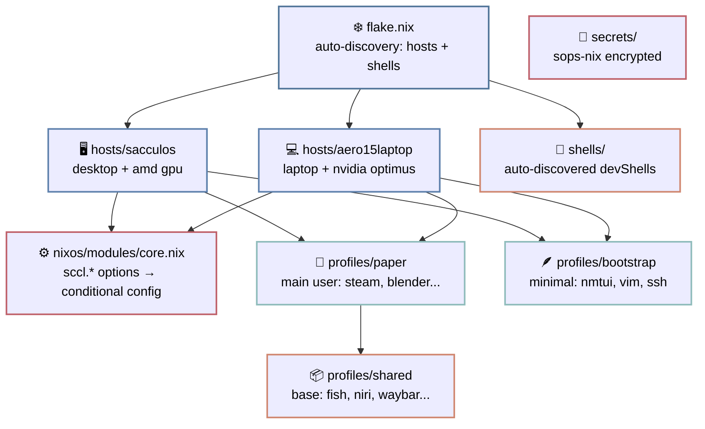

# Если эта shitpost-like статья выглядит как шиза
Нормальная дока на ангельском: [github/scclie/sccl_nix/README.md](https://github.com/scclie/sccl_nix)


# ~~На*&я~~ Зачем?

Вот мне раньше, после 6 лет юза онли арча - тоже это не было понятно.
Мол наплодили ещё какой-то попсовый дистр, аля федоры, манжары и прочих качи.

А потом мне захотелось его установить...

После этого, видимо, мой мир перевернулся.
Куча проблем, что возникали на обычных дистрах моментом решились.
Мне даже ранее не казалось, что это проблемы - за годы использования стандартных дистров ловишь консенсус - просто привыкаешь к тому, как над в них работать, чтоб всё было заебись.
Но то заебись и это заебись - это совершенно два разных заебись.

Как вываливали в какой-то очень старой мысли, ещё на заре придумывания Nix - пакетники, на самом деле, можно сравнить с ЯП. (щас бегло удалось найти ток про Guix, но где-то эта мысль звучала даже ранее https://en.wikisource.org/wiki/Functional_Package_Management_with_Guix)

Аля есть процедурные пакетники - стандартные apt, yum, pacman и т.д. (т.е. типа все императивные пакетники, де ты ручками всё ставишь, иль пишешь под ето последовательные скрипты)
И декларативные пакетники - как раз nix и есть ещё guix - это уже типа как функциональный подход, де ты больше описываешь результат.

а дальше чо? Какой-то более высокоуровневый подход, более абстрактный? (иль мега абстрактный llm-based chat interface??????? - ai problem resolver :D )

Ну да ладно, щас пока nix -- это лучшее, что у нас есть. И вот почему.

Императивный подход в линуксе выглядит как: `apt install что-то`, потом `systemctl enable что-то`, потом ручками конфиг в `/etc/что-то/что-то.conf`. Система накапливает состояние, а ты понятия не имеешь, как она дошла до жизни такой. Хуярить ебучий git для `/etc`? fr

NixOS предлагает обратное (собсна как и в сравнении функ и процедур ЯП): ты описываешь конечный результат. Все пакеты, конфиги, юзеры, сервисы - один файл(ну можно не один...), один билд, одно состояние. Не "поставь это и то" (PKGBUILD), а "вот такая у меня должна быть система". Хочешь вторую машину? Те же конфиги, другой хост. Хочешь откатиться? Въёбываешь предыдущую генерацию. Система иммутабельна - каждый билд лежит в `/nix/store` (всё в куче говна, но красиво подтягивается симлинкаи), ничего не раскидывается по `/usr` и `/etc` как попало.

А ещё отдельный кайф с шеллами. Часто приходится ставить на оси "одноразовые проги" - поставил - юзанул - забил...
А оно ведь всё лежит в системе ;k
Никс предлагает шеллы - можш накидать туда любых прог, поюзать, забыть - да потом оно само удалится.
Сами эти зависимости так же идут в `/nix/store` и тянутся только в твой шелл.
Ну и в добавок можно просто в env накатить любую прогу, да при закрытии терминала, да срабатывании garbage collector - она удалится.

# Мой конфиг. А он то ~~на*&я~~ зачем?

Потому, что необдуманный NixOS конфиг - это всегда один и тот же сценарий:

Сначал ты "аккуратно структурируешь". Потом добавляешь второй хост. Потом третий. Прог всяких сыпешь, конфигов, исключений. И `/etc/nixos` превращается в помойку с условными `if hostname == ...`

> "ладно, сейчас я это нормально рефакторну"

*(нет)*

Собственно, из этого и родился **sccl_nix** - моя конфигурация, которая пытается не превратиться в помойку. (пару раз превращалась, но я очень стараюсь)


# Чотут?

Дотфайлы разделены на три сущности: машина, пользователь, и всё что надоело копировать.

`hosts` - железо и вся системная чепуш: диски (disko), драва (GPU), сеть, системные пакеты. Всё, что нельзя синкать между разными машинами.
`profiles` - это уже человек со своими прогами, шеллом и user-level хламом. На одном хосте может быть сколько угодно профилей.
`shared` - базовые пакеты, конфиги, шелл, дев тулзы. Один раз настроил, импортнул во все профили. Крч база для всех.

Сейчас у меня два хоста: **sacculos** (десктоп на видяхе амуде) и **aero15laptop** (ноут с нвидиа). Хосты авто-дискаверятся флейком - кидаешь папку в `hosts/`, он сам подхватывает.

Профилей пока два: **paper** -- мой основной со всем зоопарком прог на все случаи жизни, и **bootstrap** -- минимальный (~1-2 GB), только vim, nmtui и ssh. Он нужен для установки с флешки: накатил bootstrap, загрузился, переключил `sccl.bootstrap = false`, перебилдил -- и вот у тебя полная система. Не надо ждать, пока на слабом ноуте соберётся 100500 пакетов с флешки, на которой ещё и места нет.
(для решения такой задачи можно юзать nixos-anywhere, но как бекап вариант остаётся опционально)


## sccl.* 

Главная штука, которая не даёт конфигу скатиться в свалку `if hostname == ...`

В `core.nix` определены все опции и они по дефолту `false`. Каждый модуль гейтит сам себя: `lib.mkIf config.sccl.audio.enable`. Не нужен zapret на ноуте? Просто не пишешь `sccl.zapret.enable = true`. Всё.

```
sccl.ui.enable           # Nord-тема + greetd
sccl.audio.enable        # pipewire
sccl.bluetooth.enable    # bluetooth + blueman
sccl.net.enable          # networkmanager + прокси + firewall
sccl.automount.enable    # udisks2 автоподключение флешек
sccl.secrets.enable      # sops-nix шифрованные секреты
sccl.zapret.enable       # обход DPI
sccl.flclashx.enable     # FlClashX GUI для прокси
sccl.playground.enable   # Docker
sccl.nix-ld.enable       # nix-ld для бинарников не из nixpkgs
sccl.bootstrap           # bool: минимальный режим установки
```

И конфиг хоста выглядит буквально так:

```nix
sccl = {
  ui.enable = true;
  audio.enable = true;
  net.enable = true;
  automount.enable = true;    # только на десктопе
  zapret.enable = true;       # только на десктопе
  playground.enable = true;   # только на десктопе
  nix-ld.enable = true;
};
```

## Секреты

SSH-ключи, GPG - всё это зашифровано через sops-nix с age-ключом и лежит прямо в репе. Всё что над хранить - приватный age.

При ребилде с `sccl.secrets.enable = true` ключи сами расшифровываются в `~/.ssh/`, GPG импортится.


## Клава

Раскладка параметризована через аргументы флейка. 
У sacculos эрго-сплит на Vial прошивке -- `us,rulemak_vial`. 
У aero15laptop -- `colemak_dh,rulemak`. Один `mkHost` в `flake.nix`, и все слои (системная клава, XKB, WM) получают правильную раскладку. Без копипасты и костылей.

На уровне WM-а (niri) раскладка тоже передаётся параметром: на десктопе Colemak-CAWS, на ноуте Colemak-DH-Wide. Удобно, когда у тебя разные клавиатуры с разной прошивкой и разными раскладками на разных машинах.


## Как эт связано

Вот схемка как оно всё собирается в кучу. Флейк авто-дискаверит хосты и шеллы, хосты подключают модули и профили, профили тянут shared-конфиги.



# Подвох?
Ну конечно при большом скилле и тут можно насрать
