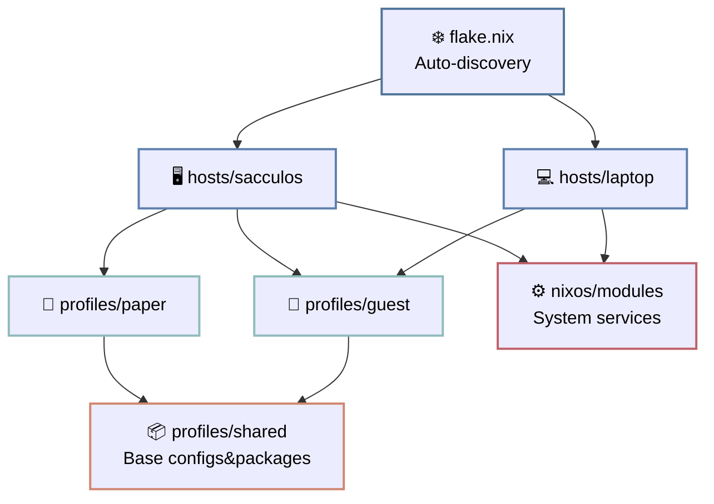

# Если этот shitpost-like статья выглядит как шиза
Нормальная дока на ангельском: [github/scclie/sccl_nix/README.md](https://github.com/scclie/sccl_nix)

# ~~На*&я~~ Зачем?

Потому, что необдуманный [NixOs](https://nixos.org/) config - это всегда один и тот же сценарий:

- сначал "аккуратно структурируешь"
- добавляешь второй хост
- потом третий
- прог всяких сыпешь, конфигов, исключений
- `/etc/nixos` превращается в помойку с условными `if hostname == ...`
> "ладно, сейчас я это нормально рефакторну"

*(нет)*

---

# Чотут?

Дотфайлы разделены на 3 сущности:

- `hosts` - железо и вся системная шалуха
- `profiles` - пользователь
- `shared` - всё, что ты устал копировать

машина != пользователь != окружение

---

## hosts
Всё, что нельзя синхронить между разными машинами

- диски
- дрова
- network
- system packages

## profiles

Это уже "человек"

- окружение(-я)
- свои проги
- настройки шелла
- весь этот user-level мусор

На одном хосте может быть сколько угодно профилей, хоть для разных людей, хоть под какие-то свои задачи.
Система билдится под хост, а профили подтягиваются

## shared

Это попытка остановить копипасту

- базовые пакеты
- wm конфиги
- дефолтные штуки

---

## Как эт связано

Максимально просто:

# Подвох?
Ну конечно при большом скилле и тут можно насрать, накидав зависимостей *не туда*
